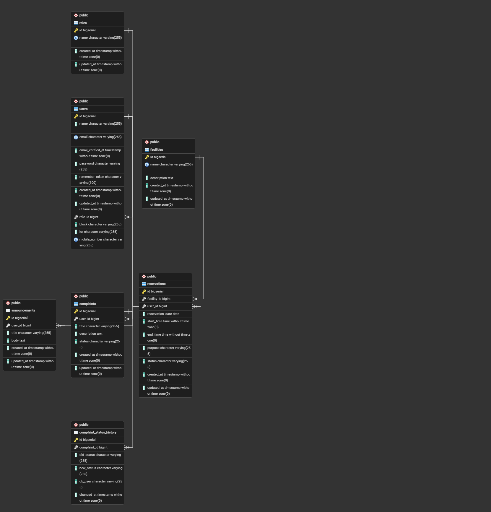

# Makati Home Ville Community Management System

A web-based community management system for the Makati Home Ville HOA (Dayap, Calauan, Laguna), built with Laravel and PostgreSQL. This is the midterm slice of our capstone project for COMP 016 Web Development.

**Group members:** Anthony Baldoza, Dexilou Barotia, Aaron Nidea

## Features (midterm scope)

- Registration, login, and logout. Residents register with their block, lot, and mobile number.
- Three roles: **HOA Admin**, **Resident**, and **Facility Staff**, enforced by route middleware
- **Announcements:** the Admin creates, edits, and deletes; all logged-in users can read
- **Complaints:** Residents file complaints and see only their own; the Admin sees all and updates the status (Pending, In Progress, Resolved)

Planned after the midterm: facility reservation with conflict detection, emergency alerts with SMS, and SMS help requests. The Facility Staff role exists but has no features yet.

## Requirements

- PHP 8.3 or newer
- Composer
- PostgreSQL 17 (with the `pdo_pgsql` PHP extension enabled)

## Setup

1. Clone the repository and install dependencies:

```bash
   git clone https://github.com/AnthonyBaldoza/Makati-Home-Ville-Capstone.git
   cd Makati-Home-Ville-Capstone
   composer install
```

2. Create the environment file and application key:

```bash
   copy .env.example .env
   php artisan key:generate
```

3. In pgAdmin, create an empty database named `mhv`.
4. Edit `.env` so the database lines read:

```
   DB_CONNECTION=pgsql
   DB_HOST=127.0.0.1
   DB_PORT=5432
   DB_DATABASE=mhv
   DB_USERNAME=postgres
   DB_PASSWORD=your_postgres_password
```

5. Run the migrations and seeders from a clean database:

```bash
   php artisan migrate:fresh --seed
```

6. Start the server and open http://127.0.0.1:8000:

```bash
   php artisan serve
```

## Demo accounts

| Role           | Email             | Password      |
| -------------- | ----------------- | ------------- |
| HOA Admin      | admin@mhv.test    | admin12345    |
| Resident       | resident@mhv.test | resident12345 |
| Facility Staff | staff@mhv.test    | staff12345    |

New accounts created through the registration page are always Residents.

## Database design

| Table           | Purpose                                                                                             |
| --------------- | --------------------------------------------------------------------------------------------------- |
| `roles`         | HOA Admin, Resident, Facility Staff                                                                 |
| `users`         | accounts, with a `role_id` foreign key to `roles`, plus block, lot, and mobile number for residents |
| `announcements` | posted by an Admin (`user_id` foreign key)                                                          |
| `complaints`    | filed by a Resident (`user_id` foreign key), `status` defaults to Pending                           |

Design decisions:

- **Separate `roles` table** instead of a role column: the foreign key prevents invalid roles, role names are stored once (normalization), and adding a new role is one new row. Trade-off: one extra table and a join.
- **`restrictOnDelete` on foreign keys:** announcements and complaints are HOA records, so a user with records cannot be deleted by accident.
- **Complaint status is a string**, validated with `Rule::in([...])`, because there are only three fixed values. A lookup table would be more normalized but heavier than needed here.
- **Block, lot, and mobile number are nullable** because Admin and Staff accounts do not live in a lot. The mobile number is unique because the SMS module will use it to identify who sent a help request.
- **Profile fields were added in a separate migration** instead of editing the original users migration, so existing databases can be updated without being rebuilt.

## Security decisions

- Role checks happen on the server through the `role` middleware, not only by hiding buttons in views.
- `role_id` is never taken from the registration form; the server assigns Resident.
- Complaint `user_id` and `status` are not mass assignable; `user_id` is set through the `complaints()` relationship and `status` is changed only by the Admin-only route.
- A Resident who opens another Resident's complaint by URL receives a 403.
- Forms use `@csrf`, passwords are hashed, and output is escaped with `{{ }}`.
- Registration validates the mobile number format (`09` followed by 9 digits) and rejects duplicates.

## Project structure

- `routes/web.php`: routes and middleware groups
- `app/Http/Controllers/`: `AuthController`, `AnnouncementController`, `ComplaintController`
- `app/Http/Middleware/EnsureUserHasRole.php`: role check (registered as `role`)
- `app/Models/`: `Role`, `User`, `Announcement`, `Complaint`
- `database/migrations/` and `database/seeders/`: schema and demo data
- `resources/views/`: Blade views using the shared `layouts/app.blade.php`
- `public/css/app.css`: plain CSS, no build step required

## Database administration (COMP 018)

### ERD



### Setup order

The database objects are created in this order. Running `migrate:fresh` drops every table, so the grants must be applied again afterward:

```bash
php artisan migrate:fresh --seed
psql -h 127.0.0.1 -U postgres -d mhv -f database/admin/roles.sql
```

On Windows, `psql` is at `C:\Program Files\PostgreSQL\17\bin\psql.exe`.

### Backup and restore

- `database/admin/backup.bat` runs `pg_dump` in custom format (`-Fc`) and writes `backups\mhv_<date>.dump`. Backups are ignored by Git.
- `database/admin/restore.bat <file>` restores a dump into a new database called `mhv_restore`, so the original database is never overwritten.
- Both scripts read the password from the `PGPASSWORD` environment variable. It is never stored in the repository.

```powershell
$env:PGPASSWORD="your_postgres_password"
.\database\admin\backup.bat
.\database\admin\restore.bat backups\mhv_2026-10-15_1902.dump
```

Restore was verified by comparing row counts of `users`, `roles`, `announcements`, and `complaints` in `mhv` and `mhv_restore`; they matched.

### Roles and privileges

`database/admin/roles.sql` creates two PostgreSQL roles in addition to the owner (`postgres`):

| Role           | Privileges                                                                                            | Purpose                                                      |
| -------------- | ----------------------------------------------------------------------------------------------------- | ------------------------------------------------------------ |
| `mhv_app`      | SELECT, INSERT, UPDATE, DELETE on all tables, sequence usage; read-only on `complaint_status_history` | Used by Laravel at runtime. It cannot create or drop tables. |
| `mhv_readonly` | SELECT on `roles`, `announcements`, `complaints`, and non-secret columns of `users`                   | Reporting. It cannot modify data or read password hashes.    |

Verified behavior:

- `mhv_readonly`: `DELETE FROM complaints` fails with `permission denied`, and `SELECT password FROM users` fails with `permission denied`.
- `mhv_app`: `DROP TABLE complaints` fails with `must be owner of table complaints`, and `DELETE FROM complaint_status_history` fails with `permission denied`.

The default passwords in `roles.sql` are for the demo only and must be changed in a real deployment.

### Index and EXPLAIN

The complaints list for a Resident filters by `user_id` and sorts by `created_at`. PostgreSQL does not index foreign key columns automatically, so a composite index was added in migration `add_user_created_index_to_complaints_table`:

```sql
CREATE INDEX complaints_user_id_created_at_index ON complaints (user_id, created_at);
```

It was tested on a copy of the database (`mhv_restore`) loaded with 100,000 complaints for 2,000 users:

```sql
EXPLAIN (ANALYZE, BUFFERS)
SELECT * FROM complaints WHERE user_id = 1000 ORDER BY created_at DESC;
```

|                | Without the index                            | With the index    |
| -------------- | -------------------------------------------- | ----------------- |
| Plan           | Seq Scan (99,951 rows removed by the filter) | Bitmap Index Scan |
| Buffers        | 1,423                                        | 56                |
| Execution time | 18.916 ms                                    | 0.419 ms          |

A Sort step remains in the plan because the 50 matching rows are spread across 50 table pages, so the planner collects them with a bitmap and sorts them in memory.

### Trigger and function

`log_complaint_status_change()` and the trigger `complaints_status_audit` write a row to `complaint_status_history` (complaint, old status, new status, database user, time) whenever a complaint's `status` actually changes. It is created in migration `create_complaint_status_history_table`.

- It runs inside the database, so it records changes no matter who makes them (the app, pgAdmin, or a script).
- The function is `SECURITY DEFINER`, so `mhv_app` does not need INSERT rights on the history table and cannot edit the audit trail.
- It uses `session_user` so the real login is recorded.
- Updating a complaint to the same status does not create a row.

### Laravel connection settings

Laravel connects through the `pgsql` connection in `config/database.php`, which reads these values from `.env`:

```
DB_CONNECTION=pgsql
DB_HOST=127.0.0.1
DB_PORT=5432
DB_DATABASE=mhv
DB_USERNAME=postgres
DB_PASSWORD=your_postgres_password
```

Use `postgres` to run migrations and seeders. To run the application with least privilege, set `DB_USERNAME=mhv_app` and `DB_PASSWORD=change_me_app`, then run `php artisan config:clear`. This was verified: the application worked normally, and a status change made in the browser was recorded in `complaint_status_history` with `db_user = mhv_app`.
